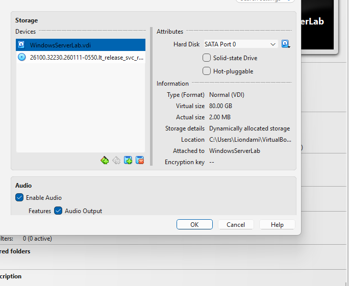
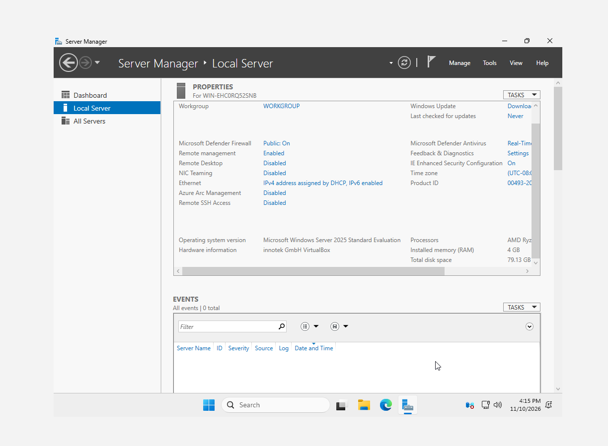

# 01 — VirtualBox and Windows Server setup

This chapter highlights the main milestones with selected screenshots. Captions describe the screens shown; they do not imply unverified tests succeeded.

## Step 1: VirtualBox VM configuration during the initial Windows Server setup.

## Step 2: Windows Server Manager running in the virtual machine.

