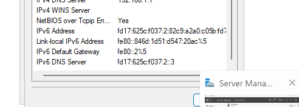
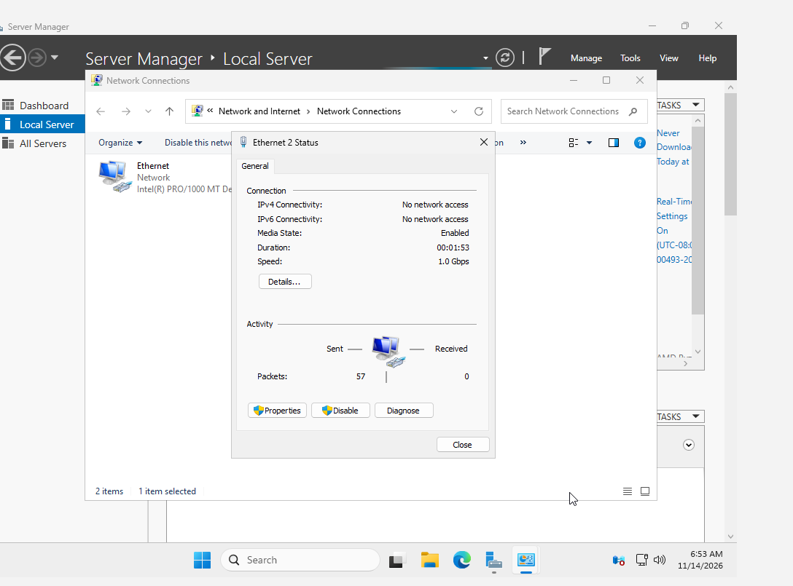

# 02 — Windows Server network preparation

This chapter highlights the main milestones with selected screenshots. Captions describe the screens shown; they do not imply unverified tests succeeded.

## Step 1: Windows Server network adapter details.

## Step 2: Network adapter configuration screen.

