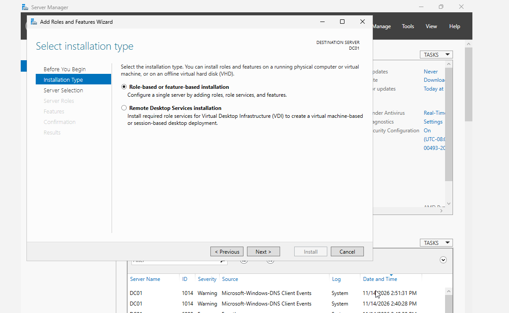
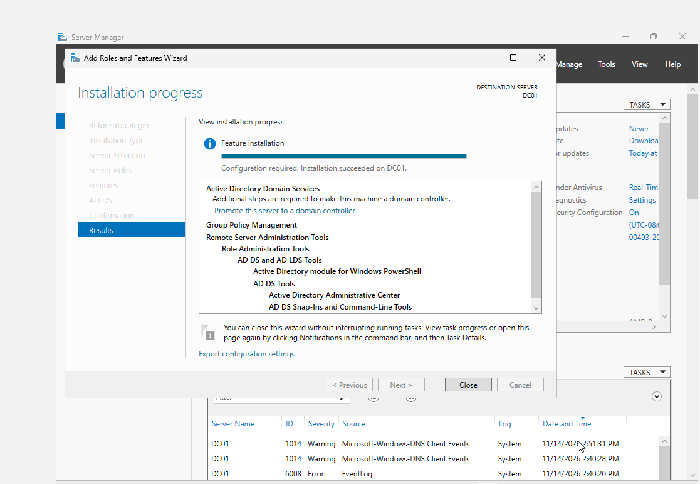
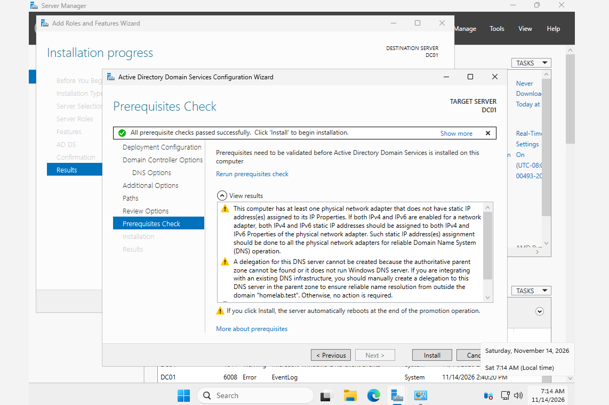
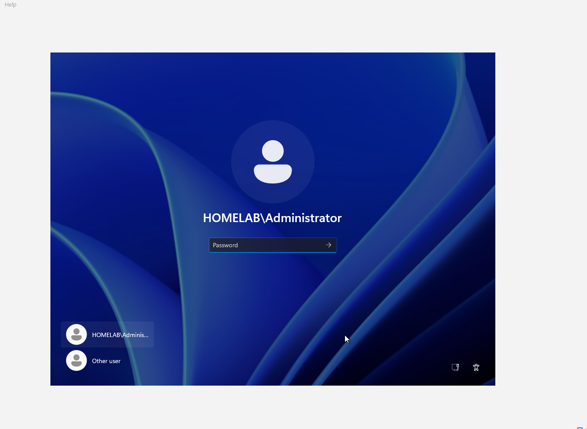
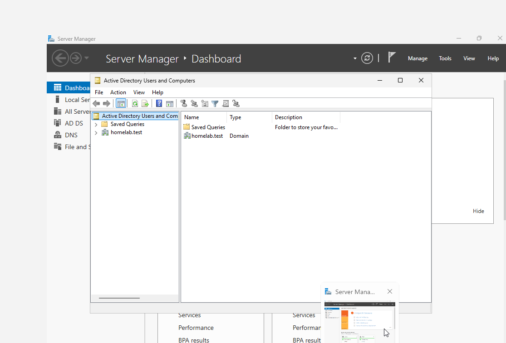

# 03 — Active Directory installation and domain creation

This chapter highlights the main milestones with selected screenshots. Captions describe the screens shown; they do not imply unverified tests succeeded.

## Step 1: Add Roles and Features Wizard.

## Step 2: AD DS installation progress.

## Step 3: Domain controller prerequisite checks.

## Step 4: Domain administrator sign-in after promotion.

## Step 5: Active Directory Users and Computers showing the domain.

