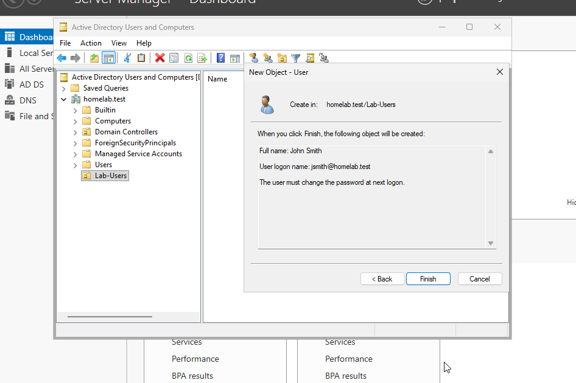
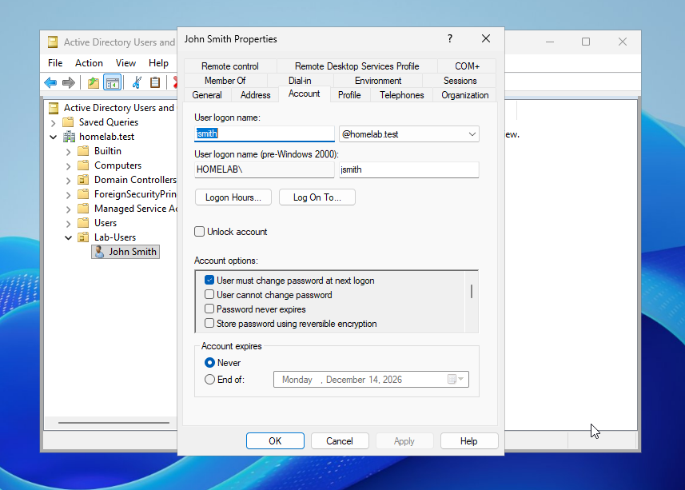
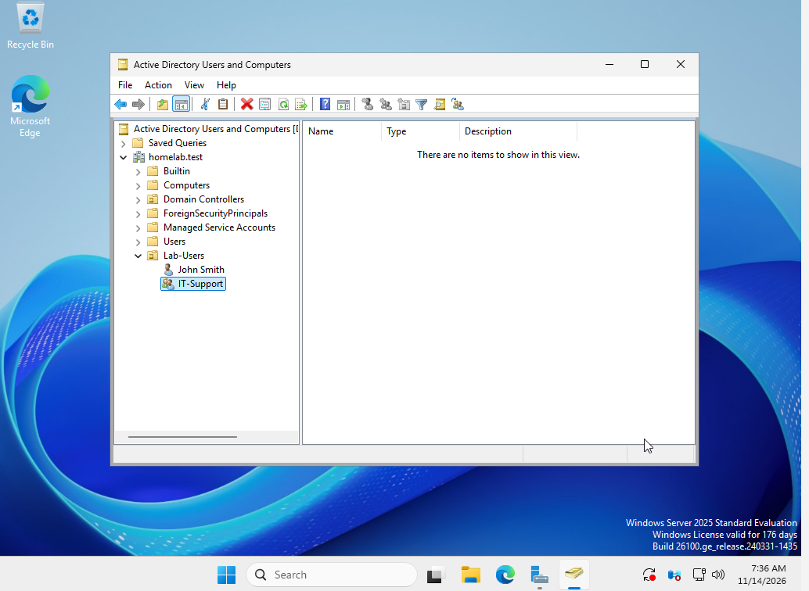
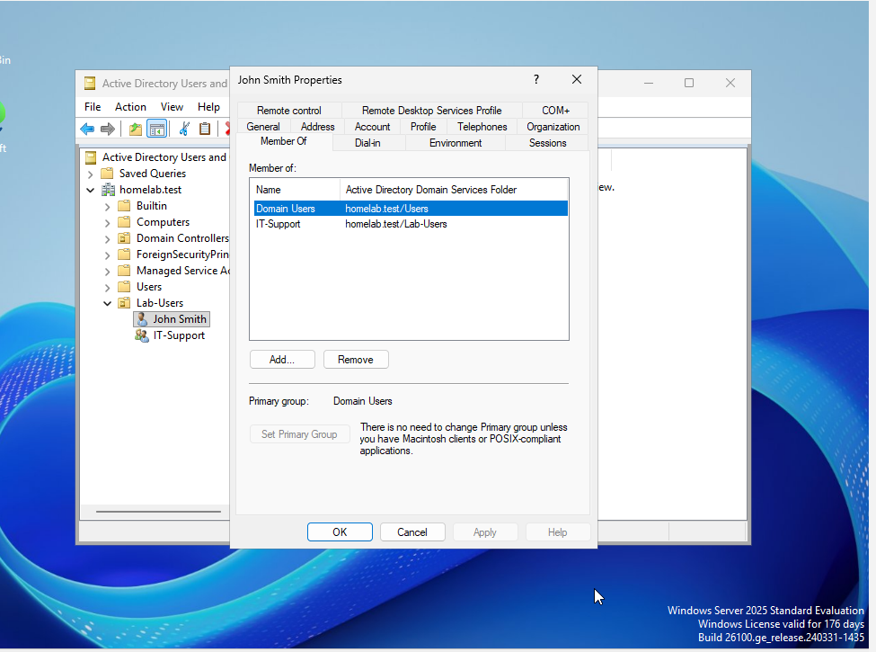

# 04 — Organizational units, user accounts and groups

This chapter highlights the main milestones with selected screenshots. Captions describe the screens shown; they do not imply unverified tests succeeded.

## Step 1: New user creation in Active Directory.

## Step 2: User account configuration.

## Step 3: IT-Support security group in Active Directory.

## Step 4: Verification of the test user's group membership.

