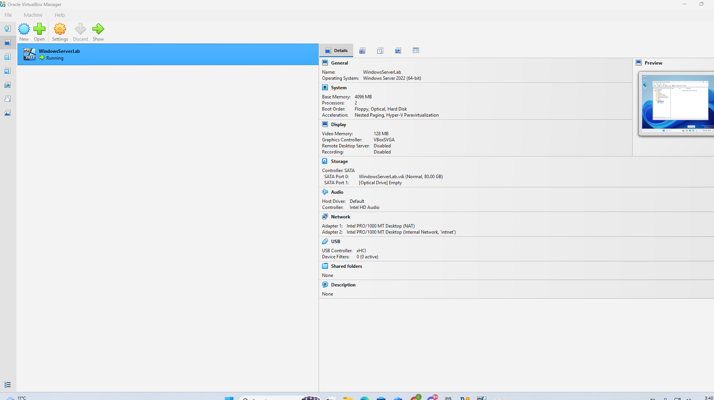
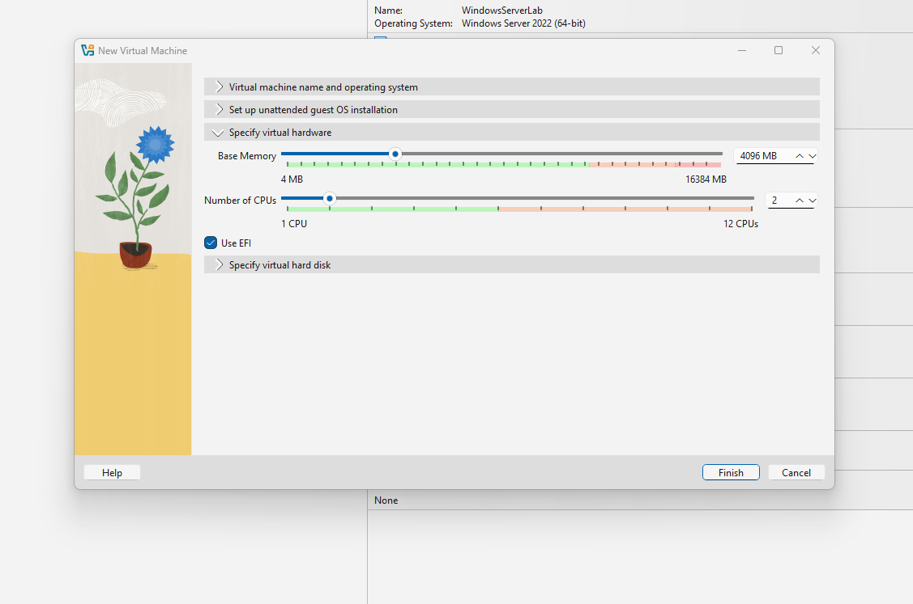
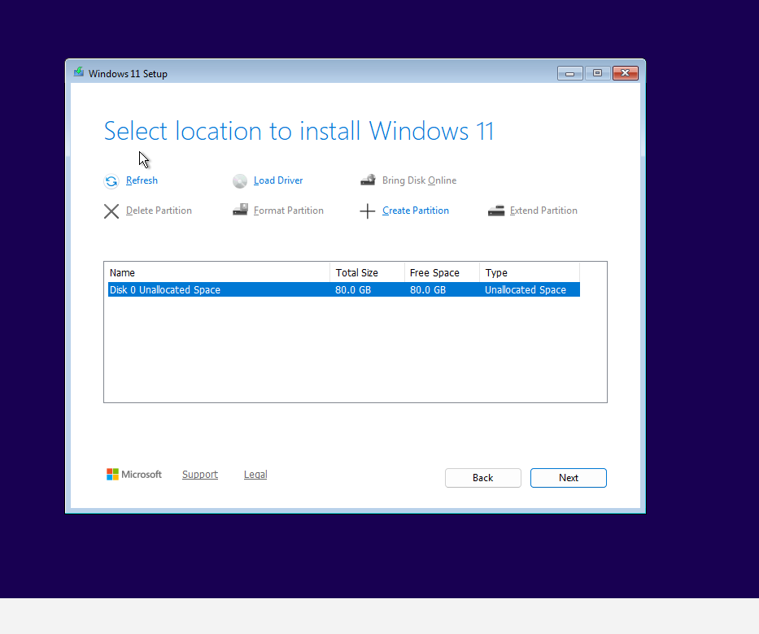
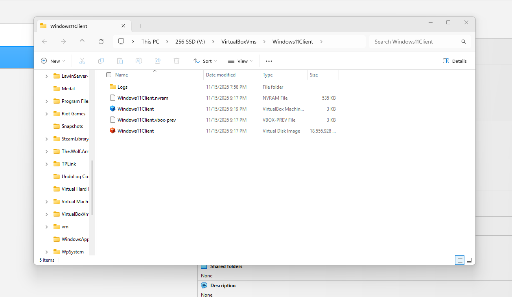
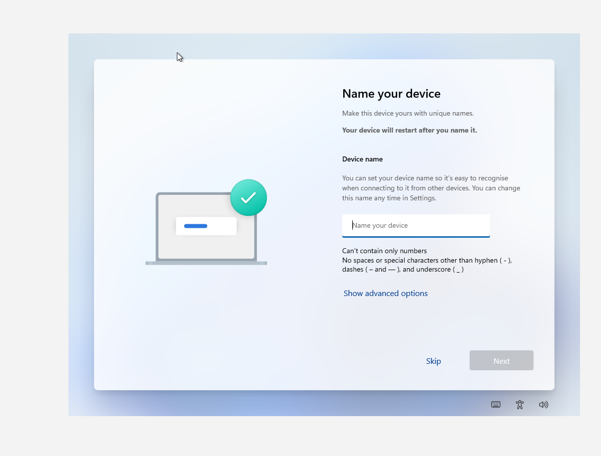
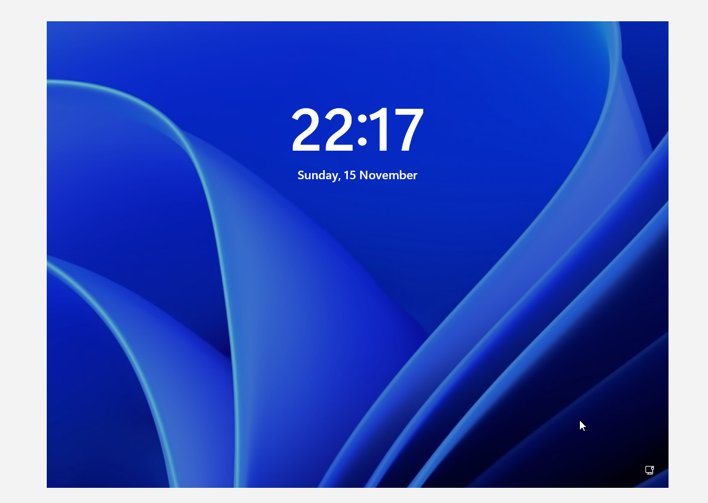

# 05 — Windows 11 client installation and troubleshooting

This chapter highlights the main milestones with selected screenshots. Captions describe the screens shown; they do not imply unverified tests succeeded.

## Step 1: Windows 11 VM shown in VirtualBox.

## Step 2: Windows 11 VM hardware settings.

## Step 3: Windows 11 installation disk selection.

## Step 4: Moving the VM to the secondary drive after storage trouble.

## Step 5: Windows 11 initial setup and device naming.

## Step 6: Windows 11 client lock screen after installation.

