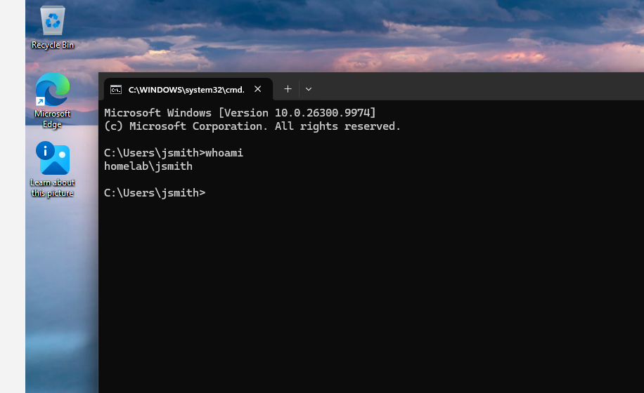
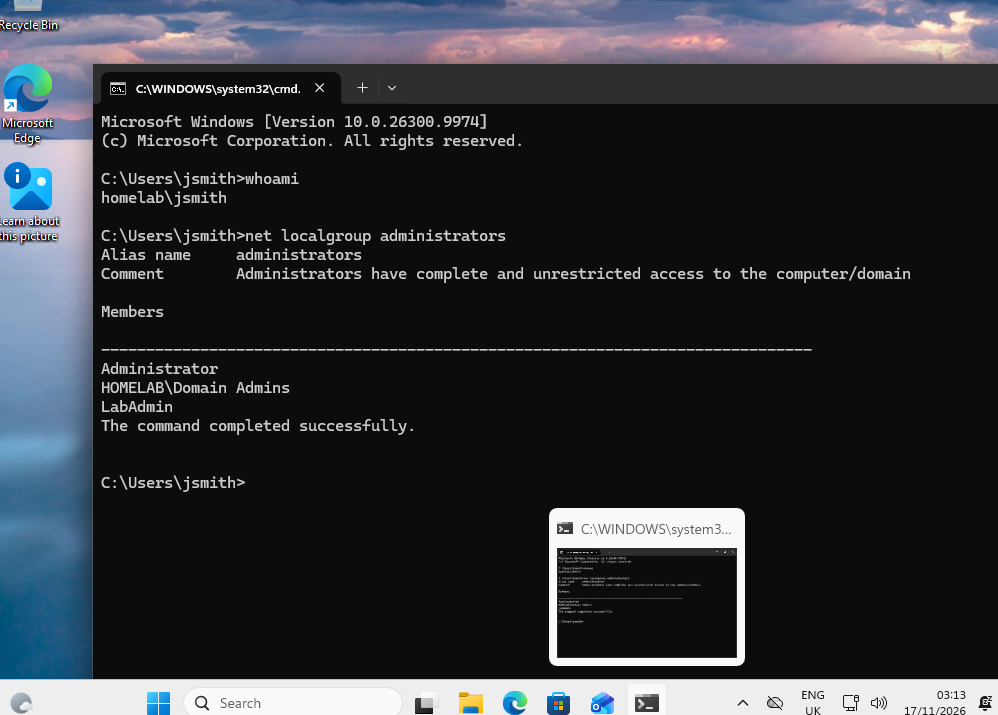
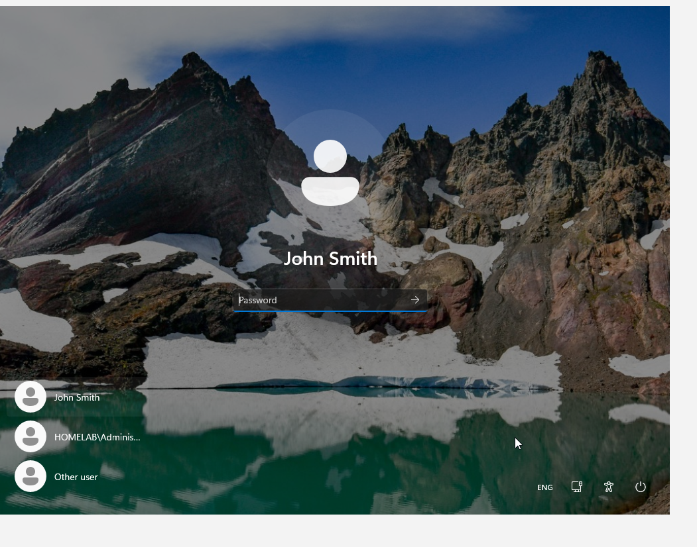

# 06 — Windows 11 domain join and sign-in

The Windows 11 Pro client was joined to `homelab.test`. John Smith (`HOMELAB\jsmith`) successfully signed in. The screenshots below provide sign-in and account-context evidence; the precise join-wizard sequence is not captured in this selected set.

## Evidence and walkthrough

### 1. Domain sign-in verified using whoami

### 2. Local administrators group check on the Windows 11 client

### 3. Windows 11 sign-in screen displaying John Smith

## Result

**Completed:** Windows 11 client joined to `homelab.test` and `HOMELAB\jsmith` logged in successfully.
