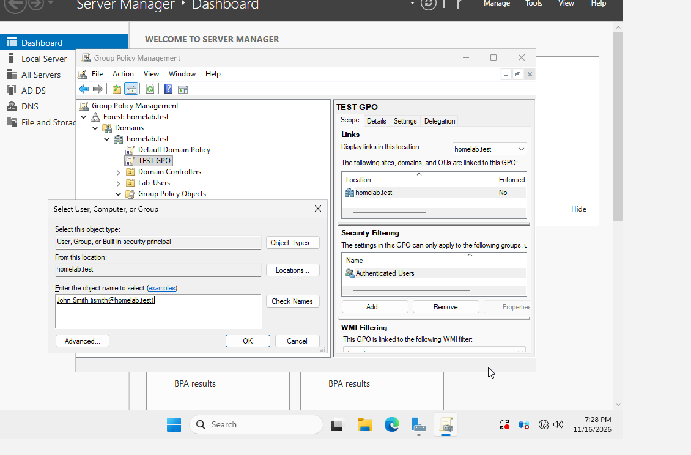
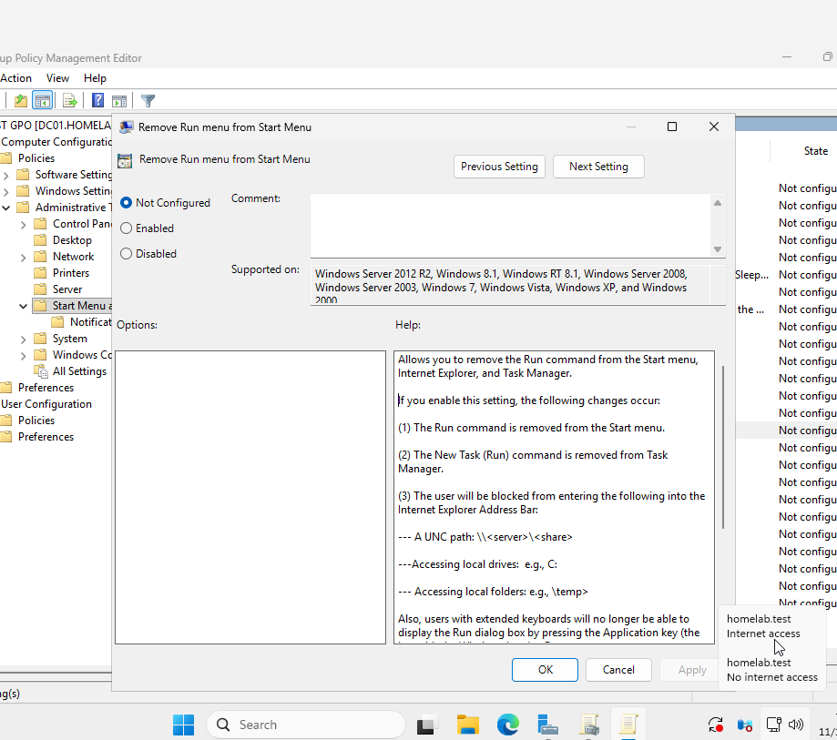
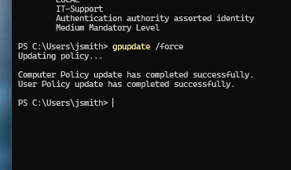
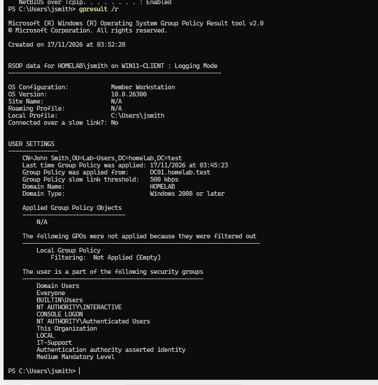
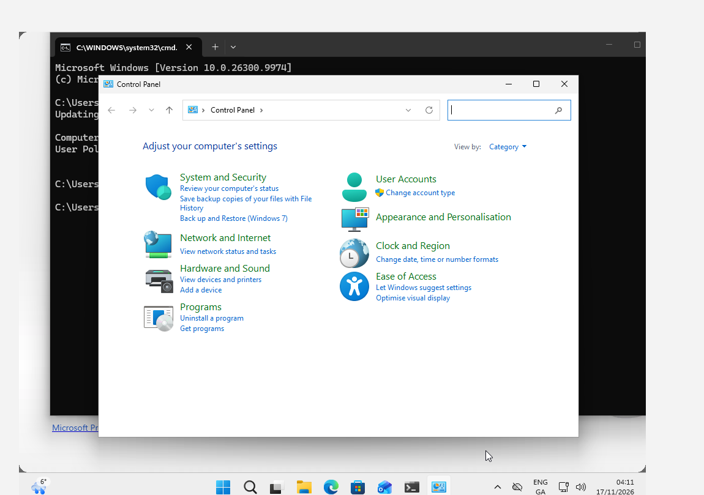
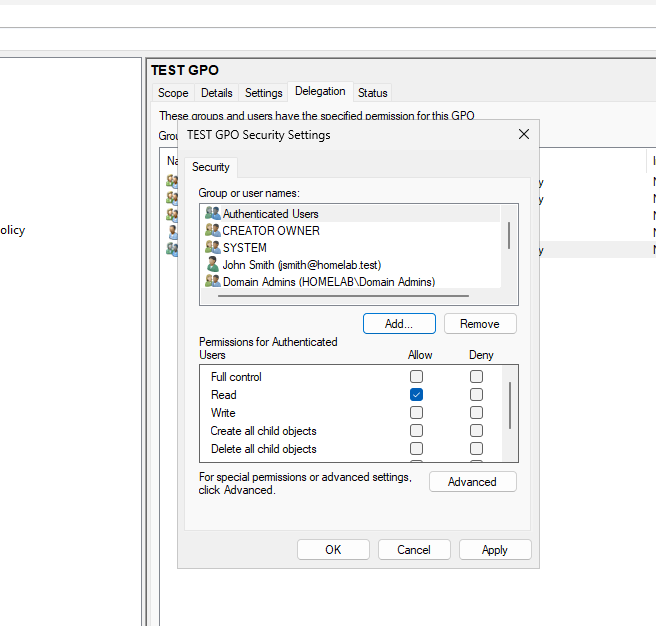
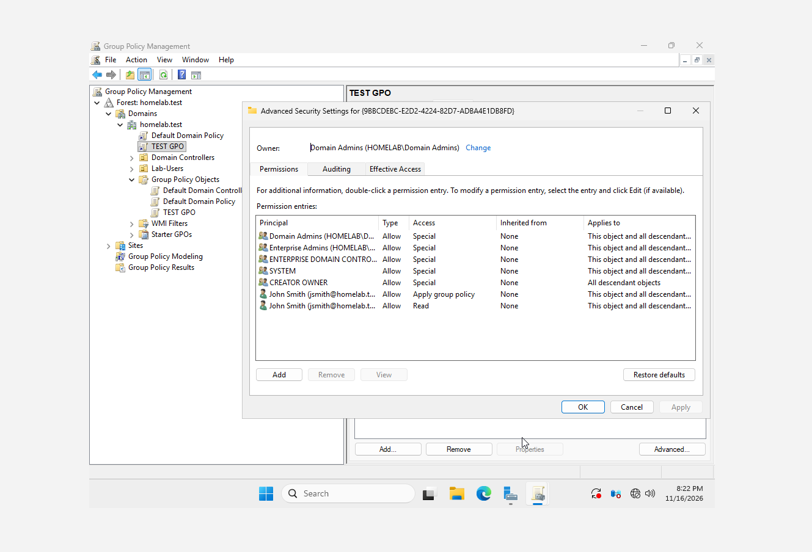
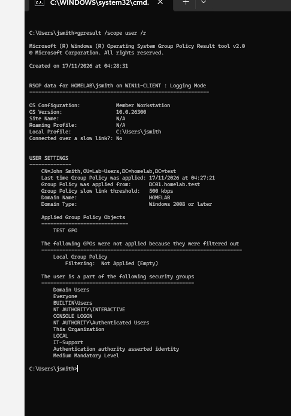
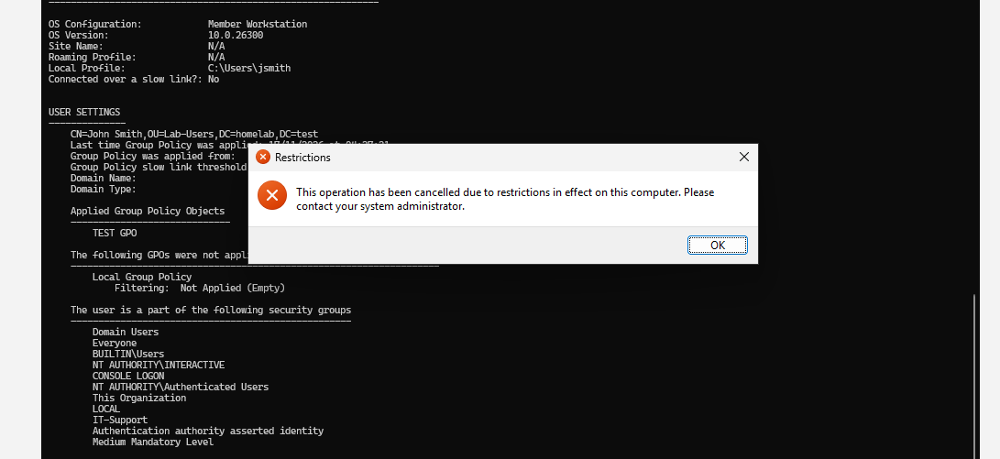

# 07 — Group Policy: Control Panel restriction

**Objective:** Restrict access to Control Panel and PC Settings for the test user through a domain Group Policy Object. On `DC01`, created `TEST GPO`, linked it to `homelab.test`, and enabled **User Configuration → Policies → Administrative Templates → Control Panel → Prohibit access to Control Panel and PC settings**. The GPO was scoped for the test user; the initial test failed, and permissions were adjusted to permit policy processing.

## Evidence and walkthrough

### 1. TEST GPO linked to homelab.test and security filtering

### 2. Control Panel restriction policy enabled

### 3. gpupdate force succeeds for computer and user policies

### 4. Initial gpresult output: no user GPO applied

### 5. Control Panel initially accessible: policy not yet enforced

### 6. GPO security permissions inspection

### 7. Updated GPO security permissions for domain policy processing

### 8. Final gpresult shows TEST GPO under Applied Group Policy Objects

### 9. Control Panel restriction confirmed with Windows Restrictions message

## Result

**Completed and verified:** Following the security-permission change and policy refresh, `gpresult` listed **TEST GPO** as applied to `HOMELAB\jsmith`. Opening Control Panel displayed the Windows message: “This operation has been cancelled due to restrictions in effect on this computer. Please contact your system administrator.” This is evidence the custom restriction was enforced.
